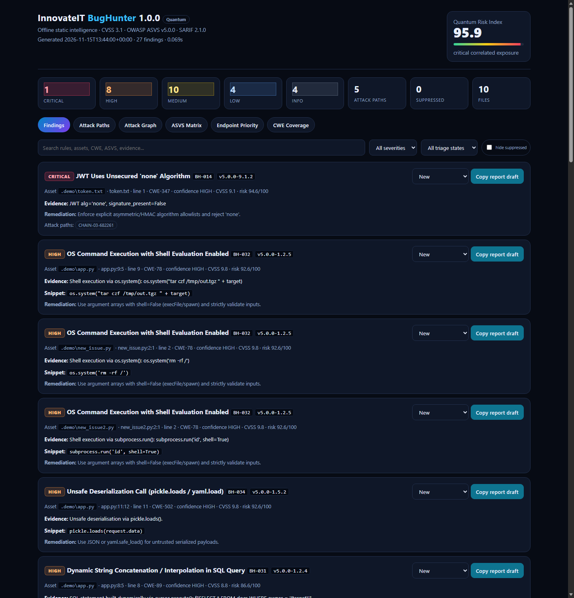

# InnovateIT BugHunter v1.0 "Quantum"

Upgrade of `youknowho_hunter.py` (v0.6.0). Single file, Python 3.9+ standard library
only, no network access unless you explicitly run `recon`.



_Demo dashboard generated from a deliberately vulnerable fixture (not a real target)._

- Tool: [`youknowho_hunter_v1.py`](youknowho_hunter_v1.py)
- Tests: [`tests/test_bughunter.py`](tests/test_bughunter.py)
- Feature deep-dive: [`SPECIAL_FEATURES.md`](SPECIAL_FEATURES.md)

## What changed vs v0.6.0

| Area | v0.6.0 | v1.0 |
|---|---|---|
| Severity scoring | Fixed labels | Real CVSS 3.1 base score computed from a per-rule vector, calibrated exploitability, 0–100 risk score |
| Correlation | None | 8 declarative attack-path chains (`CHAIN-01…08`) + portfolio **Quantum Risk Index** |
| Python analysis | Regex only | Stdlib `ast` intra-procedural taint: `request.*` → SQL/command/SSRF/template/serialization sinks, route extraction, framework detection |
| JS analysis | Regex on raw source | String/comment masking that preserves offsets, fixed-point taint propagation, more sources/sinks, sanitizer awareness, origin-check parsing |
| Secret scanning | 7 patterns | 14 providers + DB URIs + bearer literals, placeholder filtering, per-match line/column, redaction |
| JWT | 4 checks | Adds expired-token and remote-key (`jku`/`x5u`/`jwk`) checks; literal JWTs found in any text artifact |
| IaC / CI | Dockerfile root/privileged | Dockerfile pinning + user, Kubernetes host namespaces/hostPath/privilege, GitHub Actions injection + action pinning |
| OpenAPI | 2 checks | Adds inherited-security detection and recursive response-schema inspection |
| HAR | 24 checks, opaque APS | Sensitive query params, auth schemes, content types, explainable APS breakdown, normalized ghost-route matching, role diff with row estimates |
| Recon | Redirect-following urllib, TOCTOU DNS | DNS-pinned HTTP client, no redirects, token bucket, TLS 1.2 floor, weak TLS detection, optional sensitive-path probes, explicit `--insecure` for self-signed targets |
| Suppressions | None | `.bughunterignore` / `--suppress` JSON (fingerprint, stable id, rule, path glob, expiry, reason) + inline `bughunter:ignore` comments |
| Baselines | Manual diff only | `--baseline` marks new/unchanged/updated; `--fail-on-new` gates only regressions |
| SARIF | Rules + results | 2.1.0 with regions/snippets, rule indexes, ranks, CWE/ASVS taxonomies, invocations, baseline state, suppression objects |
| Reports | JSON/SARIF/MD/HTML | All four, escaped HTML, QRI gauge, attack-path view, ASVS/CWE/endpoint tabs, triage persistence |
| Robustness | Sequential, quadratic line lookups | Parallel scanning with deterministic output, O(log n) line index, file-size/binary guards, output-dir exclusion, JSON/YAML spec support |
| CI gate | Findings only | Findings **and** correlated attack paths, new-only mode |
| Tests | 1 inline smoke test | 75-check `self-test` + 35-case `unittest` suite |

## Usage

```bash
# Auto-detect everything under a repo (source, JS, IaC, CI, OpenAPI, HAR)
python youknowho_hunter_v1.py scan ./src --out reports --fail-on CRITICAL HIGH

# HAR-only, scope-filtered, with suppression and baseline
python youknowho_hunter_v1.py audit-har capture.har --scope example.com \
    --suppress .bughunterignore --baseline previous.json --fail-on-new

# JavaScript / source-map audit
python youknowho_hunter_v1.py audit-js ./dist

# Backend + Dockerfile + Kubernetes + workflows
python youknowho_hunter_v1.py audit-repo . --jobs 8

# OpenAPI / Swagger (JSON natively; YAML with optional PyYAML)
python youknowho_hunter_v1.py audit-openapi openapi.json

# Role-based authorization parity
python youknowho_hunter_v1.py diff-roles admin.har user.har --scope example.com

# Passive recon (explicit authorization required; no redirects)
python youknowho_hunter_v1.py recon https://app.example.com \
    --scope example.com --i-have-authorization --rps 2 \
    --probe-sensitive --format json html

# Merge artifacts, diff runs, verify install
python youknowho_hunter_v1.py fuse reports/*_findings.json
python youknowho_hunter_v1.py diff old.json new.json
python youknowho_hunter_v1.py self-test
```

Exit codes: `0` clean/below gate · `2` CI gate triggered · `3` usage/input error ·
`4` internal error · `130` interrupted.

## New rules (37–45)

| Rule | Finding | Severity |
|---|---|---|
| BH-037 | CI workflow command injection / untrusted `pull_request_target` checkout | HIGH |
| BH-038 | JWT verification disabled or algorithm not pinned | HIGH |
| BH-039 | Credential-like value in URL query string | MEDIUM |
| BH-040 | Sensitive config/backup file reachable | LOW |
| BH-041 | Kubernetes host namespace or hostPath | MEDIUM |
| BH-042 | Deprecated TLS version or weak cipher | MEDIUM |
| BH-043 | Unpinned container image or CI action | MEDIUM |
| BH-044 | Dynamic backend code evaluation (`eval`/`exec`) | HIGH |
| BH-045 | Server-side template injection sink | HIGH |

## Suppression file format

```json
{
  "suppressions": [
    {"rule_id": "BH-013", "path": "tests/**", "reason": "fixture key", "expires": "2027-01-01"},
    {"fingerprint": "0f3c…", "reason": "accepted risk"},
    {"stable_id": "9a12…", "reason": "false positive"}
  ]
}
```

Inline: `// bughunter:ignore BH-013 fixture key` (same line),
`# bughunter:ignore-next-line BH-032`, or `bughunter:ignore-file BH-039`.

## Quantum Risk Index

Each finding's exploitability is `CVSS/10` blended with analyzer confidence.
A chain's probability is the **product** of its links (all preconditions must hold),
with a 0.9 feasibility factor. The portfolio QRI is a noisy-OR of the strongest
finding/chain with a capped breadth signal (0.02 per critical/high finding, max 0.25),
capped at 99. It answers "how exposed is this artifact set now?", not "how many tickets".

## Verification

```bash
python youknowho_hunter_v1.py self-test          # 75 checks
python -m unittest discover -s tests -v          # 33 integration/regression cases
```

## Limitations (unchanged philosophy)

- Static heuristics are triage aids, not proof. Confirm every finding in an
  authorized environment before reporting.
- Python taint is intra-procedural; JS taint is assignment-based, not a full parser.
- No vulnerability database lookups; supply-chain checks cover pinning only.
- `recon` performs real HTTP requests: only run it against assets you are
  explicitly authorized to test.
